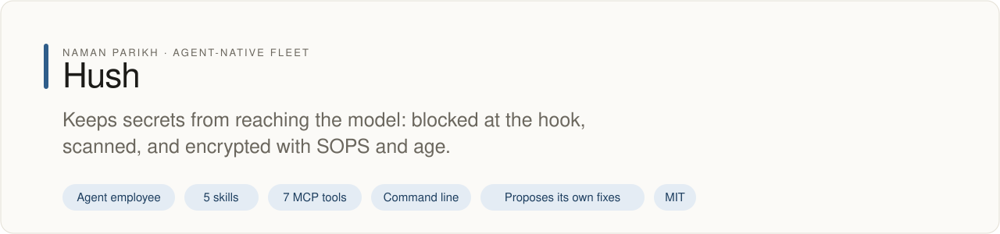
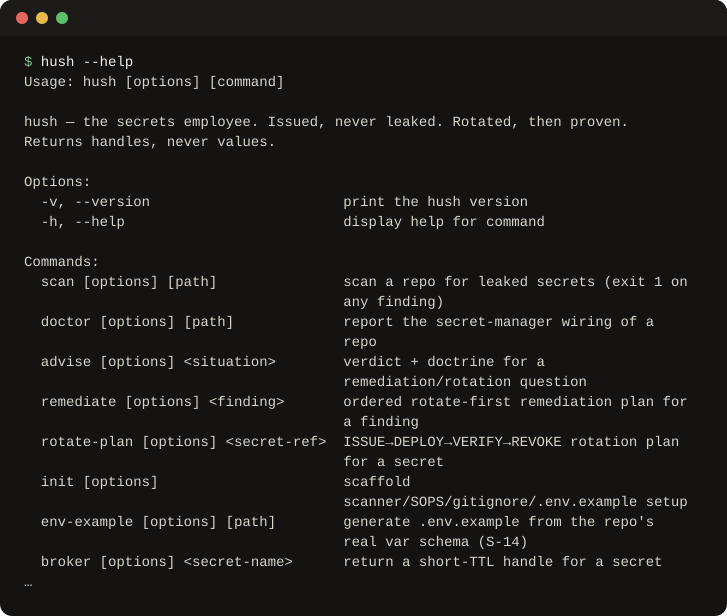

# hush

<!-- fleet:header:start -->
<p align="center"><picture><source media="(prefers-color-scheme: dark)" srcset="assets/banner-dark.svg"></picture></p>

<p align="center">
<a href="https://github.com/naman10parikh/hush/actions/workflows/ci.yml"></a>
<a href="https://github.com/naman10parikh/hush/releases"></a>
<a href="LICENSE"></a>
<a href="#use-it-from-any-coding-agent"></a>
<a href="https://x.com/naman10parikh"></a>
<a href="https://www.linkedin.com/in/naman-parikh1/"></a>
</p>

<p align="center"><a href="#quick-start">Quick start</a> · <a href="docs/README.md">How it works</a> · <a href="AGENTS.md">AGENTS.md</a> · <a href="llms.txt">llms.txt</a> · <a href="skills/">Skills</a> · <a href="https://github.com/naman10parikh/hush/discussions">Discussions</a> · <a href="https://github.com/naman10parikh">All projects</a></p>

**Keeps secrets from reaching the model: blocked at the hook, scanned, and encrypted with SOPS and age.**

Hush is an agent employee, a packaged specialist agent with its own skills, memory and tests. It owns one job: secrets. Coding agents use it through its skills, its MCP server and its command line. A scheduled job runs its evals and proposes fixes. A person makes every change.

_Hush is part of an agent-native play for agent-native systems that can eventually be recursively self-improving and evolving, operated by agent employees._

<p align="center"></p>
<!-- fleet:header:end -->

Its job is to keep secrets out of git, out of logs and out of an agent's context. When a key leaks, hush gives
the real fix: rotate the key at the provider, prove the rotation, then scrub. Every tool returns a handle, a
verdict or a redacted finding, never a raw secret.

<!-- fleet:use:start -->
## Use it from any coding agent

**Claude Code**: the plugin brings the skills, sub-agents, hooks and MCP server.

```
/plugin marketplace add naman10parikh/hush
/plugin install hush@hush
```

<details><summary>Its MCP server, Codex, Cursor, Gemini CLI, one skill and the command line</summary>

**Its MCP server**, in any MCP client:

```bash
claude mcp add --transport stdio hush -- npx -y -p github:naman10parikh/hush hush-mcp
codex mcp add hush -- npx -y -p github:naman10parikh/hush hush-mcp
```

Cursor (`.cursor/mcp.json`), Gemini CLI (`.gemini/settings.json`) and most other clients take the same command as JSON:

```json
{
  "mcpServers": {
    "hush": {
      "command": "npx",
      "args": [
        "-y",
        "-p",
        "github:naman10parikh/hush",
        "hush-mcp"
      ]
    }
  }
}
```

**Gemini CLI**: the extension brings the context and the MCP server.

```bash
gemini extensions install https://github.com/naman10parikh/hush
```

**One skill** (5 in all, in [skills/](skills/)), in any agent that reads Agent Skills:

```bash
gemini skills install https://github.com/naman10parikh/hush --path skills/secret-leak-remediation
git clone --depth 1 https://github.com/naman10parikh/hush /tmp/hush && cp -r /tmp/hush/skills/secret-leak-remediation ~/.claude/skills/
```

**The command line:**

```bash
npx -y -p github:naman10parikh/hush hush --help
```

</details>

Codex, Cursor, OpenCode, GitHub Copilot and other agents read [AGENTS.md](AGENTS.md); Claude Code reads [CLAUDE.md](CLAUDE.md) and Gemini CLI reads [GEMINI.md](GEMINI.md), which import it. [llms.txt](llms.txt) maps every surface for agents that read first.
<!-- fleet:use:end -->

## Quick start

No clone needed: npm builds hush from GitHub on first use.

```bash
npx -y -p github:naman10parikh/hush hush --help
npx -y -p github:naman10parikh/hush hush advise "I ran git rm --cached on the leaked .env, are we fixed?"
```

The second command answers `verdict: false-green`. A false-green looks fixed but is not. Un-tracking a file
leaves the key live in git history, so the fix is to rotate the key first.

In a clone, the acceptance test plants a fake key in a throwaway repository, checks that `hush scan` flags it
and that a clean repository passes, three times, offline:

```bash
pnpm install && pnpm build && bash sandbox/run-acceptance.sh
```

It ends with `ACCEPTANCE PASS`.

## How it works

**The one rule.** Every CLI command and MCP tool returns a handle (`hush://store/<name>`), a verdict or a
redacted finding, never a value. A value goes to the process that needs it, never to the model, a log or a
commit.

**What it refuses.** Sign-in and user identity are out of scope. hush uses a machine identity and never owns
one. It will not call a leak fixed after `git rm --cached` or `sops updatekeys` alone.

**Encrypted, scanned, brokered.** hush encrypts nothing itself. `hush init --sops` writes a `.sops.yaml`, so
[SOPS](https://github.com/getsops/sops) encrypts secret files with [age](https://github.com/FiloSottile/age)
keys. It lists a second, break-glass recipient, and it creates the first age key when `age-keygen` is
installed. `hush scan` runs its own offline scanner. It adds [gitleaks](https://github.com/gitleaks/gitleaks)
when gitleaks is installed, with hush's baseline config if the repository has none, so decoys such as
`password = "password"` pass. With `--verify` it adds [trufflehog](https://github.com/trufflesecurity/trufflehog),
which reports only keys that still work. `hush broker` returns a handle and an expiry time, never the value.

**The commands** (each takes `--json`, and a finding exits nonzero):

```text
hush scan [path] [--staged] [--history] [--verify] [--mcp-config]   # the scanning stack
hush doctor                       # how well this repository keeps its secrets
hush advise "<situation>"         # verdict and doctrine; flags false-greens
hush remediate <finding|file>     # ordered rotate-first plan; the scrub needs consent
hush rotate-plan <secret-ref>     # issue, deploy, verify, revoke
hush init [--scanner|--sops|--gitignore|--env-example]   # scaffold the setup hush recommends
hush env-example [path] [--write] # .env.example from the variables the code reads
hush broker <name> [--ttl]        # a short-lived handle, never a value
hush inject -- <cmd>              # run a child process with secrets through a file mount
hush tool <job>                   # the layer to use for a job
hush runs [--view]                # the redacted run log
```

**The guard.** A PreToolUse hook (`.claude/hooks/secret-scan-gate.js`) blocks a secret-shaped string before it
enters a command or a file, and a literal secret written into `.mcp.json`.

**The brain.** Six files in [brain/](brain/) hold the judgment: the 12 jobs, the stances, version-pinned
pitfalls, real incidents (the golden tasks), the tool matrix and the open disputes. Query it with
`bash scripts/memory-search.sh "<question>"`.

**Isolation.** CI runs the acceptance test on a fresh runner. `node sandbox/run-in-sandbox.mjs --boot` runs it
in an E2B microVM built from `sandbox/Dockerfile`. That is a billed call, so it only happens on that flag.

## Limits

**What hush stops:**

- A secret-shaped string in a Bash command or in a Write or Edit, before Claude Code runs it. The guard knows
  the key formats of Anthropic, OpenAI, AWS, GitHub, Slack, Google and Stripe. It also catches JSON web
  tokens, private key blocks and long random-looking tokens.
- A literal secret written into `.mcp.json`. A `${VAR}` reference passes.
- A commit or a CI run that carries a secret, once `hush init --scanner` adds the gitleaks pre-commit hook and
  a CI workflow (gitleaks, plus trufflehog for keys that still work).
- A raw value in its own output. Every tool returns a handle, a verdict or a redacted finding, and the run log
  is redacted.

**What hush cannot stop:**

- A command you approve that prints a value, such as `printenv`. The guard reads what goes into a command, not
  what comes out, so that value enters the agent's context.
- A secret with no known format and little randomness, such as a short password.
- A key that already reached a remote. A scan finds it, but only a rotation at the provider fixes it.
- Missing values. hush has no secret store yet. `hush inject -- <cmd>` runs the command with the environment
  it already has, and reports the order it would deliver secrets in: a file mount first, never a committed
  env file. The values come from a manager you run, such as OpenBao or Vault.
- Agents without the hook. The guard runs where the plugin's hook is installed, in Claude Code. Other agents
  get the scanner, the MCP tools and the skills.

<!-- fleet:anatomy:start -->
## What it is made of

Every project in this fleet is graded on the same 11 harness components and on self-improvement. Each mark is backed by a file you can open.

| Component | Grade | Where |
| --- | --- | --- |
| Identity | ✅ | identity/SOUL.md:8 + identity/BRAND.md:5 |
| Memory | ✅ | memory/MEMORY.md:1 + scripts/memory-search.sh:1 |
| Skills | ✅ | skills/secret-leak-remediation/SKILL.md:1 |
| Tools/CLIs | ✅ | package.json:6 + src/cli/index.ts:1 |
| Hooks | ✅ | .claude/settings.json:4 + hooks/hooks.json:4 |
| Sub-agents | ✅ | .claude/agents/hush-remediation-planner.md:1 |
| MCPs | ✅ | src/mcp/tools.ts:44 + bin/hush-mcp:1 |
| Dispatch | ✅ | src/dispatch/route.ts:159 + .github/workflows/rsi.yml:11 |
| Evals | ✅ | eval/run.mjs:1 + .github/workflows/acceptance.yml:47 |
| Observability | ✅ | src/lib/runlog.ts:51 |
| Sandbox/Infra | ✅ | sandbox/run-in-sandbox.mjs:22 |
| Self-improvement | ✅ | dsip.json:1 + .github/workflows/rsi.yml:56 |

✅ real and tested · 🟡 partial, with the reason in the row · ❌ absent
<!-- fleet:anatomy:end -->

<!-- fleet:footer:start -->
## How it improves itself

It carries its own evals and a self-improvement contract, [`dsip.json`](dsip.json), which says what it may change and how a change is judged. A scheduled job runs its evals and proposes fixes. A person makes every change. Lessons it learns are kept as rules in its memory files.

## Part of a fleet

One of the projects by [Naman Parikh](https://github.com/naman10parikh). Each owns one part of an agent's harness, or of the product around an agent, and all of them follow one standard.

| Related project | What it owns |
| --- | --- |
| [AgentDial](https://github.com/naman10parikh/agentdial) | Identity |
| [WikiMem](https://github.com/naman10parikh/wikimem) | Memory |
| [Skillsmith](https://github.com/naman10parikh/skillsmith) | Skills |
| [Agent Booster](https://github.com/naman10parikh/agent-booster) | Tools / CLIs |
| [Armory](https://github.com/naman10parikh/armory) | MCPs and the component registry |
| [AgentGrid](https://github.com/naman10parikh/agentgrid) | Dispatch |
| [AgentSwarm](https://github.com/naman10parikh/agentswarm) | Dispatch |
| [AgentBench](https://github.com/naman10parikh/agentbench) | Evals |
| [AgentMoney](https://github.com/naman10parikh/agentmoney) | Observability |
| [Claude Harness](https://github.com/naman10parikh/claude-harness) | The whole harness, as a template |

## Community

Questions and ideas go to [Discussions](https://github.com/naman10parikh/hush/discussions); bugs go to [issues](https://github.com/naman10parikh/hush/issues/new/choose). Follow the work on [X](https://x.com/naman10parikh) and [LinkedIn](https://www.linkedin.com/in/naman-parikh1/).

## Contributing and security

Read [CONTRIBUTING.md](CONTRIBUTING.md). AI-assisted pull requests are welcome. Report a vulnerability privately, as [SECURITY.md](SECURITY.md) explains.

## License

MIT, © 2026 Naman Parikh. See [LICENSE](LICENSE) and [NOTICE](NOTICE).
<!-- fleet:footer:end -->
