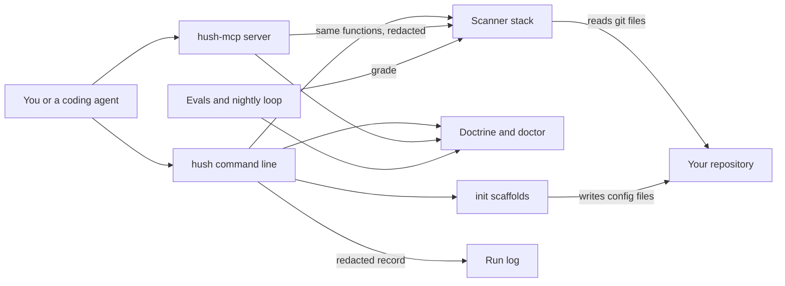

# How Hush works

Hush is a secrets helper for developers and coding agents.
A secret is a value such as an API key, a token or a private key that must never be shared.
Hush scans a repository for leaked secrets and reports how well the repository is set up to keep them out.
It also plans what to do after a leak: rotate the secret first, then clean up.
Its hard rule is that it returns handles and verdicts, never a raw secret value.
Its core scanner runs offline, with no model, no key and no extra binary.

## The parts



The command line is [bin/hush](../bin/hush), which loads the compiled program built from [src/cli/index.ts](../src/cli/index.ts).
It registers eleven commands, one module each in [src/cli/commands/](../src/cli/commands/).
Every command returns a result that [src/cli/io.ts](../src/cli/io.ts) prints as text or JSON, with a non-zero exit on findings or errors.
The MCP server in [src/mcp/server.ts](../src/mcp/server.ts) offers seven tools and the brain notes over standard input and output.
MCP, the Model Context Protocol, lets an agent call tools by name.
Every MCP result passes through `redactResult` in [src/mcp/tools.ts](../src/mcp/tools.ts) before it is sent.

The scanner stack lives in [src/scanners/](../src/scanners/).
[src/scanners/builtin.ts](../src/scanners/builtin.ts) always runs and matches known key prefixes from [src/lib/redact.ts](../src/lib/redact.ts).
gitleaks and trufflehog add their results when they are installed, and [src/scanners/mcp-config.ts](../src/scanners/mcp-config.ts) checks `.mcp.json` for literal secrets.
The advice comes from [src/lib/false-green.ts](../src/lib/false-green.ts) and [src/lib/doctrine.ts](../src/lib/doctrine.ts).
A false green is a fix that turns CI green while the leaked secret still works.
Each command writes one redacted line to `logs/runs.jsonl` through [src/lib/runlog.ts](../src/lib/runlog.ts).

## What happens when you run it

The main flow scans a repository: `hush scan . --history`.

1. [bin/hush](../bin/hush) loads `dist/cli/index.js`. Without a build it exits with code 127 and asks you to run `pnpm build`.
2. [src/cli/index.ts](../src/cli/index.ts) parses the arguments with commander and calls `scanHandler` in [src/cli/commands/scan.ts](../src/cli/commands/scan.ts).
3. `scanRepo` in [src/scanners/index.ts](../src/scanners/index.ts) first checks the path. A missing path exits with code 2 and says nothing was scanned.
4. The built-in scanner reads every git-tracked file, plus untracked files that git does not ignore. With `--history`, it also reads `git log -p --all`.
5. It skips example, schema, fixture and test files, because they carry dummy values. A folder that is not a git repository is reported as not scanned.
6. [src/scanners/gitleaks.ts](../src/scanners/gitleaks.ts) runs `gitleaks detect`, or `gitleaks protect` with `--staged`, when gitleaks is installed.
7. With `--verify`, [src/scanners/trufflehog.ts](../src/scanners/trufflehog.ts) runs trufflehog to keep only findings that still work.
8. The `.mcp.json` check runs too. Findings from every scanner are merged, and duplicates are dropped.
9. Each finding shows a rule name, a file and a redacted snippet, never the value. Any finding sets exit code 1.
10. `appendRun` logs the command, its duration and the finding count, with secret-shaped text removed.

In CI, [sandbox/run-acceptance.sh](../sandbox/run-acceptance.sh) plants a dummy key in a throwaway repository's history.
It checks three times that `hush scan` flags it and that `hush doctor` reports the repository's setup.

## Extending it

- **A command.** Add a module with a `register(program)` function in [src/cli/commands/](../src/cli/commands/), returning a `CommandResult` through `run`. Register it in [src/cli/index.ts](../src/cli/index.ts).
- **An MCP tool.** Add a descriptor to `TOOL_DESCRIPTORS` and a case to `callTool` in [src/mcp/tools.ts](../src/mcp/tools.ts). Keep the result inside `redactResult`.
- **A secret pattern.** Add a rule and a regular expression to `SECRET_PATTERNS` in [src/lib/redact.ts](../src/lib/redact.ts). Add a matching fake key under [eval/fixtures/planted/](../eval/fixtures/planted/), and keep [eval/fixtures/clean/](../eval/fixtures/clean/) free of findings.
- **A skill.** Create `skills/<name>/SKILL.md` with `name` and `description` front matter, like [skills/secret-leak-remediation/SKILL.md](../skills/secret-leak-remediation/SKILL.md).
- **An eval.** Add a golden task file to [eval/golden/](../eval/golden/), like [eval/golden/gt-03.json](../eval/golden/gt-03.json). It names a level, whether it blocks CI, a kind, its input and its assertions.

Run these before you push:

```bash
pnpm install
pnpm build
pnpm test
pnpm eval
```

## Questions

**Does it need an API key or cost money?**
No key is needed for any command or for the MCP server.
gitleaks, trufflehog and `age-keygen` are optional tools that add to what Hush can do.
If `ANTHROPIC_API_KEY` is set in the environment or in `.env`, `pnpm eval` also runs four judged tasks through the Anthropic API, billed to that key.
The optional sandbox run in [sandbox/run-in-sandbox.mjs](../sandbox/run-in-sandbox.mjs) boots a billed E2B machine only with `--boot`.

**Does any data leave the machine?**
The built-in scanner, gitleaks and the advice commands stay on your machine.
With `--verify`, trufflehog checks each candidate secret against its provider to see if it still works.
The judged eval tasks send Hush's advice text and each task's rubric to the Anthropic API.
The cockpit in [cockpit/server.mjs](../cockpit/server.mjs) listens on 127.0.0.1 only.

**How does it improve itself?**
[dsip.json](../dsip.json) declares the `agent` level, with a nightly loop and no self-grading.
[.github/workflows/rsi.yml](../.github/workflows/rsi.yml) builds Hush and runs [workflows/rsi.workflow.js](../workflows/rsi.workflow.js) every day at 09:17 UTC.
The loop asks `gh release view` for the latest versions of six pinned tools and compares them with the brain.
It rechecks key version facts in the brain, then reruns the evals that block CI.
When it finds drift and the evals pass, it writes a proposal file for a person to review. The loop never edits the brain.

**How do I run its tests or evals?**
`pnpm test` runs every `*.test.ts` file with Vitest.
After `pnpm build`, `pnpm eval` runs the golden tasks in [eval/golden/](../eval/golden/). It fails only when a task that blocks CI fails.
The four judged tasks run only with an Anthropic key, and they never block CI.
The cockpit has its own Playwright test, run with `pnpm exec playwright test`.

**What does it not do?**
It has no secret store yet. `broker` returns a `hush://store/` handle and an expiry, but stores nothing.
`inject` runs your command with your current environment and adds no secret to it.
`remediate` and `rotate-plan` print plans. They never rewrite git history or rotate a key for you.
`init --sops` makes only the first age key, and only when `age-keygen` is installed. It appends the private key, at mode 600, to the keys file sops reads.
That file is `$SOPS_AGE_KEY_FILE` if set. Otherwise it is `sops/age/keys.txt` in `$XDG_CONFIG_HOME`, or by default in `~/Library/Application Support` on macOS and `~/.config` on Linux.
It does not make the break-glass key. Replace the second recipient in `.sops.yaml` with a key you keep offline.
